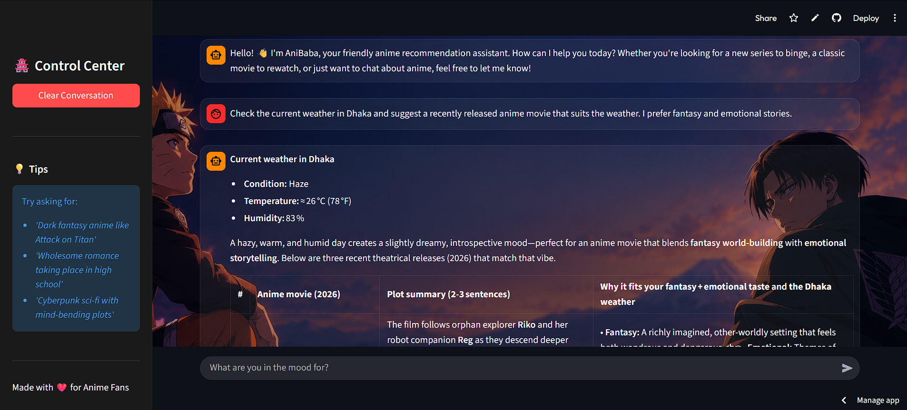
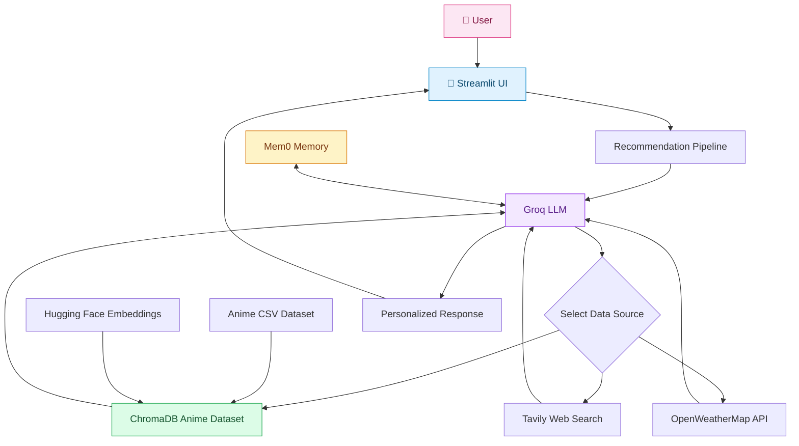

# 🌸 AniBaba — AI-Powered Anime Recommendation System

<div align="center">

[](https://www.python.org/)
[](https://streamlit.io/)
[](https://www.langchain.com/)
[](https://groq.com/)
[](https://www.trychroma.com/)
[](https://huggingface.co/)
[](https://mem0.ai/)
[](https://tavily.com/)

**Discover your next favorite anime with an AI assistant that understands your interests, remembers your preferences, searches the web, and adapts recommendations to your context.**

[🚀 Live Demo](https://ai-anime-recomender-2211.streamlit.app/) · [💻 Source Code](https://github.com/Rifat211-debug/AI-anime-recomender) · [🐛 Report an Issue](https://github.com/Rifat211-debug/AI-anime-recommender/issues)

</div>

---

## 📸 Application Preview

<div align="center">



*AniBaba's conversational interface for discovering anime.*

</div>

> **Live application:** [Try AniBaba here](https://ai-anime-recomender-2211.streamlit.app/)  

## ✨ Project Overview

Finding anime that matches a viewer's mood, interests, and viewing preferences can be difficult when recommendations rely only on static lists or generic popularity rankings.

**AniBaba** is an AI-powered anime recommendation system designed to make anime discovery more conversational, contextual, and personalized.

Built with a Retrieval-Augmented Generation (RAG) pipeline and a tool-enabled Large Language Model (LLM), AniBaba combines information from a local anime knowledge base, persistent user preferences, live web search, and current weather data to generate context-aware responses.

Rather than relying exclusively on the LLM's internal knowledge, the system can retrieve relevant anime information, search for recent releases, and incorporate external information when appropriate.

### 🎯 Key Features

- **💬 Conversational Anime Discovery:** Ask natural-language questions to discover anime movies, series, genres, themes, and recommendations.
- **🧠 Retrieval-Augmented Generation (RAG):** Retrieve relevant information from a local anime dataset using vector similarity search.
- **🔎 Semantic Search:** Use embedding-based retrieval to find relevant anime information beyond exact keyword matches.
- **🌐 Live Anime Web Search:** Integrate Tavily to search for recent anime news, movie releases, upcoming titles, announcements, and release dates.
- **🧩 Tool-Calling LLM:** Let the model select appropriate tools for local retrieval, live web search, and weather lookup.
- **💾 Persistent AI Memory:** Integrate Mem0 to retrieve and save user preferences across conversations, scoped by user ID.
- **🌦️ Weather-Aware Recommendations:** Retrieve current weather conditions through the OpenWeatherMap API to support weather-based recommendations.
- **🔗 Source-Aware Responses:** Provide source URLs from web search results to help users verify current information.
- **🎨 Interactive Streamlit Interface:** Deliver a conversational experience through a custom-themed frontend.
- **🛠️ Modular Architecture:** Separate the UI, recommendation logic, retrieval pipeline, external tools, memory management, and utilities for maintainability.


## 🏗️ System Architecture

AniBaba uses a modular architecture that combines an LLM, user memory, anime data retrieval, and external tools to generate personalized responses.




### 🔄 Request Lifecycle

1. **User input:** The user submits an anime-related question through the Streamlit interface.
2. **Memory retrieval:** The application retrieves relevant preferences associated with the supplied user ID through Mem0.
3. **Prompt construction:** The recommendation component combines the system instructions, current query, and relevant memory context.
4. **Tool selection:** The LLM can request local anime retrieval, live web search, or weather information, depending on the question.
5. **Information retrieval:** The selected tool returns relevant documents, web search results, or weather data.
6. **Response generation:** The model uses the available context to produce a natural-language response.
7. **Memory persistence:** The conversation is submitted to Mem0 for future personalization.

The actual tools invoked depend on the user's query and the model's tool-selection decisions. The system should not assume that every request requires all three tools.

## 🧰 Technology Stack

| Technology | Role in AniBaba |
|---|---|
| Python | Core application and backend logic |
| Streamlit | Interactive frontend and application interface |
| LangChain | LLM integration, prompts, tools, and tool execution |
| Groq | Hosted LLM inference |
| ChromaDB | Persistent vector storage and similarity retrieval |
| Hugging Face Sentence Transformers | Text embeddings for semantic retrieval |
| LangChain Text Splitters | Text chunking when preparing documents |
| Tavily | Live web search for current anime information |
| Mem0 | Persistent, user-scoped conversational memory |
| OpenWeatherMap API | Current weather information |
| Requests | HTTP requests to the weather API |
| pandas / NumPy | Data processing and numerical operations |
| python-dotenv | Environment-variable configuration |

The project uses the package versions pinned in `requirements.txt` for reproducibility.

## 🧠 RAG and Semantic Retrieval

AniBaba uses a local anime knowledge base and a ChromaDB vector store to retrieve information relevant to user queries.

The retrieval process is designed to support questions phrased in natural language, including queries about genres, story themes, similar anime, and viewing preferences.

At a high level:

1. Anime information is loaded from the project dataset.
2. Text representations are generated using an embedding model.
3. The embeddings are stored in ChromaDB.
4. User queries are passed to the retriever.
5. Relevant documents are provided to the LLM as contextual information.

This approach helps ground recommendations in retrieved data rather than depending solely on the model's parametric knowledge.

> **Implementation note:** The vector database is persisted locally in `chroma_db/`. Ensure the database is generated or supplied before launching the application. If the underlying dataset or embedding configuration changes, rebuild the vector store as appropriate.

## 🔎 Live Web Search and External Tools

AniBaba extends local retrieval with external tools for questions that require current information.

### Tavily Anime Search

The `search_latest_anime` tool can search for:

- Anime movies released in a specified year.
- Upcoming anime movies and announced release dates.
- Recent anime announcements and news.
- Official release information and relevant source URLs.

The tool returns search results for the LLM to interpret. Search snippets and third-party sources are not automatically verified facts; important release dates should be checked against official studios, distributors, or reliable reporting.

### Weather Integration

The `get_current_weather` tool uses OpenWeatherMap to retrieve current conditions for a specified city.

Returned fields include:

- Temperature and feels-like temperature in Celsius.
- Humidity.
- Wind speed.
- Weather description.
- City and country information when available.

These conditions can help the assistant tailor recommendations to a user's requested mood or weather context.

## 💾 Persistent Memory with Mem0

AniBaba integrates Mem0 to make recommendations more personalized over time.

The memory component supports:

- Searching for relevant user preferences.
- Saving user and assistant messages.
- Using retrieved preferences as additional prompt context.
- Scoping memory operations to a supplied user ID.

Memory is useful for retaining preferences such as favorite genres or preferred storytelling styles when those details are captured and retrieved successfully.

**Privacy and deployment consideration:** Memory separation depends on correctly assigning a distinct, stable user ID to each user. A production deployment should use authenticated identities, appropriate access controls, and secure handling of API credentials. A user ID alone is not an authentication mechanism.

## 📂 Project Structure

```text
AI-Anime-Recomender/
│
├── app/
│   ├── app.py                  # Streamlit frontend
│   └── __init__.py
│
├── config/
│   ├── config.py               # Application and model configuration
│   └── __init__.py
│
├── data/
│   ├── anime_updated.csv       # Anime dataset
│   └── anime_with_synopsis.csv # Anime descriptions and synopsis data
│
├── images/
│   ├── bg.png
│   ├── Twilight Rivals Beneath Falling Blossoms.png
│   └── ui.png                  # Add your application screenshot
│
├── memory/
│   ├── mem0_manager.py         # Mem0 integration
│   └── __init__.py
│
├── pipeline/
│   ├── build_pipeline.py       # Pipeline/vector-store preparation
│   ├── pipeline.py             # Recommendation pipeline
│   └── __init__.py
│
├── src/
│   ├── data_loader.py          # Dataset loading
│   ├── external_tools.py       # Tavily and weather tools
│   ├── prompt_template.py      # System prompt
│   ├── recommender.py          # LLM and tool-calling logic
│   ├── vectore_store.py        # Vector-store implementation
│   └── __init__.py
│
├── utils/
│   ├── bgimage.py              # Background image utilities
│   ├── custom_exception.py     # Custom exception handling
│   ├── logger.py               # Logging utilities
│   └── __init__.py
│
├── chroma_db/                  # Persisted local vector database
├── .env                        # Local API credentials (not committed)
├── .gitignore
├── .python-version
├── requirements.txt
├── setup.py
├── LICENSE
└── README.md
```

*The tree reflects the supplied project structure. Generated files, local database artifacts, and logs may differ between development and deployment.*

## 🚀 Getting Started

Follow these steps to run AniBaba locally.

### Prerequisites

- Python 3.12 recommended.
- Git.
- Internet access for hosted LLM inference and external APIs.
- API credentials for the services you want to use.
- The required anime dataset and a compatible ChromaDB vector store.

### 1. Clone the Repository

```bash
git clone https://github.com/Rifat211-debug/AI-anime-recomender.git
cd AI-anime-recomender
```

### 2. Create and Activate a Virtual Environment

**Windows PowerShell**

```powershell
python -m venv animenv
animenv\Scripts\activate
```

**macOS / Linux**

```bash
python3 -m venv animenv
source animenv/bin/activate
```

### 3. Install Dependencies

Upgrade pip and install the pinned requirements:

```bash
python -m pip install --upgrade pip
python -m pip install -r requirements.txt
```

### 4. Configure Environment Variables

Create a `.env` file in the project root:

```env
GROQ_API_KEY=your_groq_api_key
TAVILY_API_KEY=your_tavily_api_key
OPENWEATHER_API_KEY=your_openweathermap_api_key
MEM0_API_KEY=your_mem0_api_key
HF_TOKEN=your_huggingface_api_key
```

Replace the example values with your own credentials.

| Variable | Purpose | Required for |
|---|---|---|
| `GROQ_API_KEY` | Authenticates Groq API access | LLM responses |
| `TAVILY_API_KEY` | Authenticates Tavily web search | Live anime search |
| `OPENWEATHER_API_KEY` | Authenticates OpenWeatherMap | Weather lookup |
| `MEM0_API_KEY` | Authenticates Mem0 | Persistent memory |
| `HUGGINGFACE_API_KEY` | Authenticates Embedding Model | Local embeddings |

The application may require additional configuration in `config/config.py`, depending on how the model name and embedding settings are defined.

**Security:** Never commit `.env`, API keys, or private credentials to GitHub. Ensure `.env` is included in `.gitignore`. Configure secrets through your deployment platform's secret-management settings.

### 5. Prepare the Vector Database

The repository includes `chroma_db/`, which contains a persisted vector database in the supplied local project structure.

Before launching the application, verify that the database is available and compatible with the current retrieval implementation.

If the database must be generated again, inspect `pipeline/build_pipeline.py` and the vector-store implementation in `src/vectore_store.py` to confirm the supported build command and dataset path.

Do not delete an existing vector database unless you can rebuild it or have a backup.

### 6. Launch AniBaba

From the repository root, run:

```bash
python -m streamlit run app/app.py
```

Streamlit will print the local application URL in your terminal, usually:

```text
http://localhost:8501
```

Open the URL in your browser and start exploring anime recommendations.


## ⚙️ Configuration and Customization

Several components can be adapted as the project evolves:

- **LLM configuration:** Update the model configuration in `config/config.py`.
- **Prompt behavior:** Modify `src/prompt_template.py` to refine response style, recommendation rules, and source-handling instructions.
- **Retrieval settings:** Adjust the retriever and vector-store construction in `src/vectore_store.py` and `pipeline/`.
- **External tools:** Extend `src/external_tools.py` with additional data sources or tools.
- **Memory behavior:** Modify `memory/mem0_manager.py` to adapt how preferences are searched and saved.
- **Frontend:** Customize the interface and styling in `app/app.py`.

## 🧪 Testing and Troubleshooting

### Tavily returns no results

Test the search tool independently, then check the API key, returned result structure, and application logs.

### Groq rate limits

Large prompts and repeated tool calls can consume the model's token-per-minute allowance. Reduce unnecessary search results, limit repeated calls, and keep tool responses concise.

### ChromaDB errors

Verify that the vector database exists, its directory is correct, and its embedding configuration is compatible with the current code.

### Mem0 errors

Check that `MEM0_API_KEY` is configured correctly and that each user's memory operations use the intended user ID.

### Streamlit import errors

Run the application from the repository root:

```bash
python -m streamlit run app/app.py
```

This uses the active Python interpreter to launch Streamlit.

## 🔐 Limitations and Responsible Use

- Anime recommendations depend on the quality and coverage of the available dataset, retrieved documents, and LLM output.
- Web search results may be incomplete, outdated, or incorrect. Verify important release dates using authoritative sources.
- Weather-based recommendations depend on the availability and accuracy of the external weather API.
- LLM output can be nondeterministic, and external API rate limits may affect response availability.
- Persistent memory depends on the memory service, API availability, and correct user-ID isolation.
- The application is an anime discovery assistant, not a guarantee of factual completeness.

## 🗺️ Future Improvements

Potential next steps for the project include:

- [ ] Add automated unit and integration tests for retrieval, external tools, and memory.
- [ ] Evaluate recommendation relevance with a defined test dataset and measurable metrics.
- [ ] Add citations with stronger source verification and date validation.
- [ ] Introduce caching, retry policies, and graceful handling of API rate limits.
- [ ] Add structured logging and request-level observability.
- [ ] Improve user authentication and production-grade memory isolation.
- [ ] Add CI workflows and automated deployment checks.
- [ ] Explore feedback-driven recommendations and user preference controls.
- [ ] Add evaluation of retrieval quality and answer faithfulness.

## 👨‍💻 Author

**Md Salauddin Al Rifat**  

- GitHub: [@Rifat211-debug](https://github.com/Rifat211-debug)

I'm interested in building practical AI systems that combine machine learning, LLM applications, retrieval-augmented generation, and production-oriented engineering.

## 📄 License

This project includes a `MIT LICENSE` file in the repository. Refer to that file for the applicable terms of use.

---

<div align="center">

**🌸 Find your next anime adventure with AniBaba!**

*Built with Python, LangChain, Groq, ChromaDB, Mem0, Tavily, and Streamlit.*

</div>
